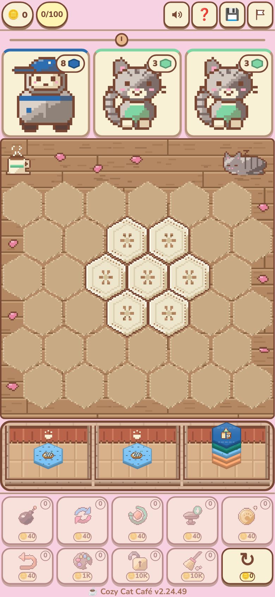

# 🐱 Cozy Cat Café

> Un juego cozy de café con clientes pixel art: apila comida en hexágonos, junta colores y sirve a 100 clientes.

**[▶ Jugar ahora](https://juliangdeveloper.github.io/cozy-cat-cafe/)** · gratis, en el navegador, sin instalar



Música: Salomón Orrego.

## Cómo se juega
- La primera partida trae un tutorial guiado: una patita de gato señala dónde tocar. El botón ❓ lo vuelve a abrir.
- Toca una bandeja y luego una mesa del tablero para apilar la comida.
- Las pilas vecinas del mismo color se juntan; cuando la cima coincide con un pedido, el cliente se sirve solo.
- La meta de cada partida es atender a 100 clientes.
- Gasta monedas en habilidades (destruir, intercambiar, refrescar y más); mantén pulsada una para ver qué hace.
- ¿Atascado? Mantén pulsada la bandera 3 segundos para reiniciar la partida (las monedas vuelven a cero).
- El progreso se guarda en tu navegador. La interfaz del juego está en inglés.

## Stack
JavaScript vanilla, HTML y CSS, con sprites pixel art y audio con [howler.js](https://howlerjs.com/) (incluido en `vendor/`). Tests con `node:test`.
Al abrirse guarda el progreso en `localStorage` (`meta.v1.cozy-cat-cafe`), que lee el [portafolio](https://juliangdeveloper.github.io/).

```
python3 -m http.server 8000   # abrir http://localhost:8000
npm test
```

## App iOS
`ios/` envuelve el juego en una app SwiftUI con `WKWebView`. Al compilar, `ios/sync-web.sh` copia los archivos web dentro de la app, así que funciona sin conexión. La versión es la de `package.json` y el build es el número de ejecución del workflow. El bundle ID está en `ios/xtool.yml`.

`.github/workflows/ios.yml` hace un archive sin firmar en cada push a `main` o `ios-testflight`. Un tag `ios-v<versión>` (por ejemplo `ios-v2.24.53`) firma con una API key de App Store Connect y sube el build a TestFlight. Secrets: `ASC_KEY_ID`, `ASC_ISSUER_ID`, `ASC_KEY_P8` e `IOS_TEAM_ID`.

---

Más proyectos: https://juliangdeveloper.github.io/

Hecho con ❤️ y 🐱
