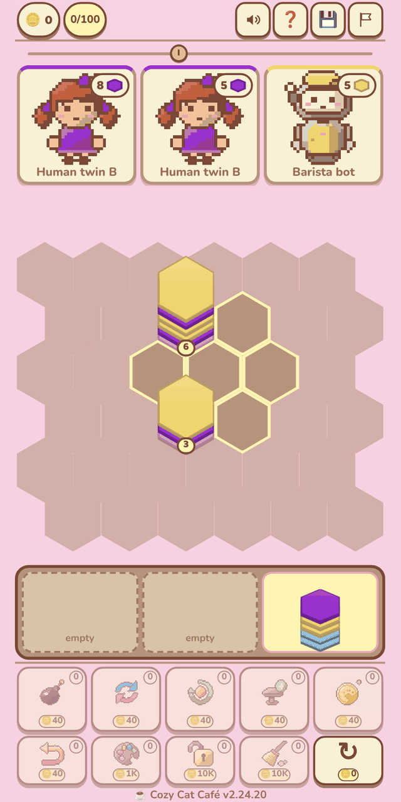

# 🐱 Cozy Cat Café

> Un juego cozy de café con clientes pixel art: apila comida en hexágonos, junta colores y sirve a 100 clientes.

**[▶ Jugar ahora](https://juliangdeveloper.github.io/cozy-cat-cafe/)** · gratis, en el navegador, sin instalar



## Cómo se juega
- Toca una bandeja y luego una mesa del tablero para apilar la comida.
- Las pilas vecinas del mismo color se juntan; cuando la cima coincide con un pedido, el cliente se sirve solo.
- La meta de cada partida es atender a 100 clientes.
- Gasta monedas en habilidades (destruir, intercambiar, refrescar y más); mantén pulsada una para ver qué hace.
- ¿Atascado? Mantén pulsado 3 segundos para reiniciar la partida.
- El progreso se guarda en tu navegador. La interfaz del juego está en inglés.

## Stack
JavaScript vanilla, HTML y CSS, con sprites pixel art y audio con [howler.js](https://howlerjs.com/) (incluido en `vendor/`). Tests con `node:test`.

```
python3 -m http.server 8000   # abrir http://localhost:8000
npm test
```

---

Más proyectos: https://juliangdeveloper.github.io/
